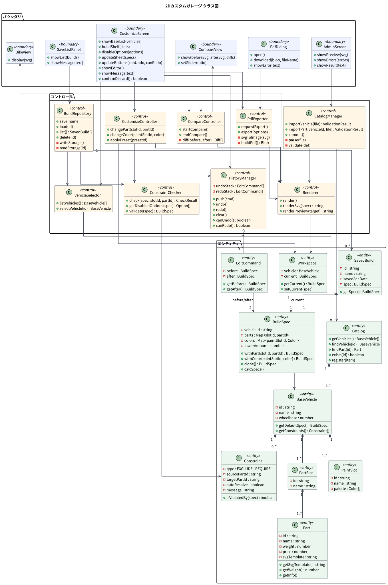
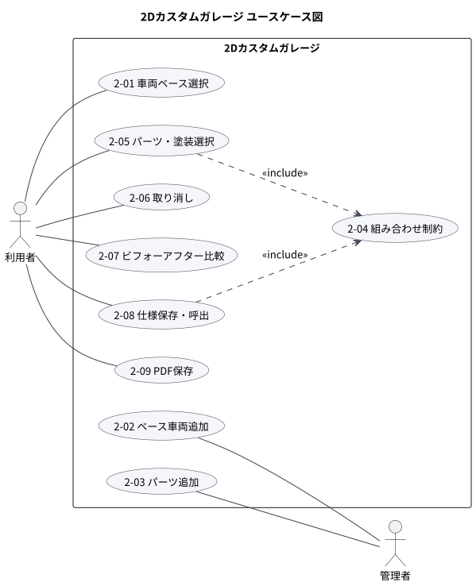

# 設計図

卒業研究で扱う9機能(2-01〜2-09)の設計図。図は PlantUML から生成している。

- [ユースケース記述](usecases.md)
- まとめて見る場合は [design.html](design.html) をブラウザで開く(GitHub上ではソース表示になるため、ダウンロードするか GitHub Pages で開く)

## クラス図

| 分類 | クラス名 | 日本語名 | 責務 |
| --- | --- | --- | --- |
| バウンダリ | `CustomizeScreen` | カスタム画面 | 車両選択、パーツ棚、ビルドシート、元に戻す・比較・PDFの各ボタンを持つメイン画面 |
| バウンダリ | `BikeView` | 車両ビュー | 描画済みの車両図(SVG)を表示する |
| バウンダリ | `CompareView` | 比較画面 | ビフォーとアフターの図、変更部位の一覧を表示する |
| バウンダリ | `SaveListPanel` | 保存一覧 | 保存済み仕様の一覧と、保存・呼出・削除の操作を受け付ける |
| バウンダリ | `AdminScreen` | 管理画面 | 車両・パーツの定義ファイルを受け付け、プレビューと検証結果を表示する |
| バウンダリ | `PdfDialog` | PDF出力ダイアログ | 用紙の向きなどの出力条件を受け付け、PDFを渡す |
| コントロール | `VehicleSelector` | ベース選択制御 | ベース車両の一覧取得と切り替え |
| コントロール | `CatalogManager` | カタログ管理制御 | 定義ファイルの読込・検証と、カタログへの登録 |
| コントロール | `ConstraintChecker` | 制約判定 | 組み合わせ制約の判定、選べない選択肢の算出、保存仕様の整合性確認 |
| コントロール | `CustomizeController` | カスタム制御 | パーツ・塗装・プリセットの変更を受けて、仕様の更新を進める |
| コントロール | `HistoryManager` | 履歴管理 | 変更履歴のスタックを持ち、取り消し・やり直しを行う |
| コントロール | `CompareController` | 比較制御 | 標準仕様と現在の仕様の差分を求め、比較画面を出す |
| コントロール | `BuildRepository` | 保存管理 | 仕様をブラウザの保存領域に読み書きする |
| コントロール | `PdfExporter` | PDF生成 | 図とビルドシートからPDFを組み立てる |
| コントロール | `Renderer` | 描画制御 | 仕様とパーツの描画データから車両図(SVG)を作る |
| エンティティ | `Catalog` | カタログ | 登録済みのベース車両とパーツの集まり |
| エンティティ | `BaseVehicle` | ベース車両 | ベース車両。部位・塗装部位・制約・標準仕様を持つ |
| エンティティ | `PartSlot` | 部位 | タンク、マフラーなどの部位 |
| エンティティ | `Part` | パーツ | 部位に取り付けるパーツ。重量・価格・描画データを持つ |
| エンティティ | `PaintSlot` | 塗装部位 | メインカラーなど色を塗り分ける部位と、その色の候補 |
| エンティティ | `Constraint` | 制約ルール | 同時に付けられない／一緒に必要、などの組み合わせルール |
| エンティティ | `BuildSpec` | 仕様 | どの部位にどのパーツ・色を付けたかを表す仕様 |
| エンティティ | `Workspace` | 作業状態 | いま編集中の車両と仕様 |
| エンティティ | `EditCommand` | 変更履歴 | 1回分の変更（変更前と変更後の仕様） |
| エンティティ | `SavedBuild` | 保存仕様 | 名前と保存日時を付けて保存した仕様 |

## ユースケース図

## ユースケースごとの図

### 2-01 車両ベース選択

記述: [usecases.md](usecases.md#2-01-車両ベース選択)

### 2-02 ベース車両追加

記述: [usecases.md](usecases.md#2-02-ベース車両追加)

### 2-03 パーツ追加

記述: [usecases.md](usecases.md#2-03-パーツ追加)

### 2-04 組み合わせ制約

記述: [usecases.md](usecases.md#2-04-組み合わせ制約)

### 2-05 パーツ・塗装選択

記述: [usecases.md](usecases.md#2-05-パーツ塗装選択)

### 2-06 取り消し

記述: [usecases.md](usecases.md#2-06-取り消し)

### 2-07 ビフォーアフター比較

記述: [usecases.md](usecases.md#2-07-ビフォーアフター比較)

### 2-08 仕様保存・呼出

記述: [usecases.md](usecases.md#2-08-仕様保存呼出)

### 2-09 PDF保存

記述: [usecases.md](usecases.md#2-09-PDF保存)

## 図の作り直し方

1. `model.py` を編集する(図の定義とユースケース記述はすべてここにある)
2. [PlantUML](https://plantuml.com/download) の `plantuml.jar` をこのフォルダに置く(Java と Graphviz が必要)
3. `python render.py` で `puml/` と `svg/` を作り直す
4. `python gen_html.py` で `design.html` を作り直す

`puml/` のファイルは astah や VS Code の PlantUML 拡張でもそのまま開ける。
